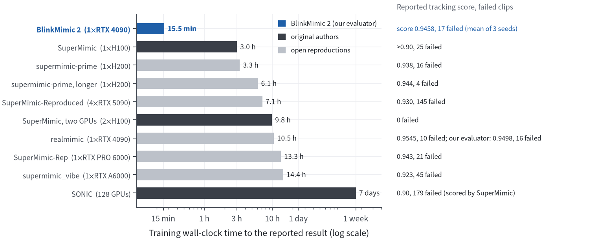
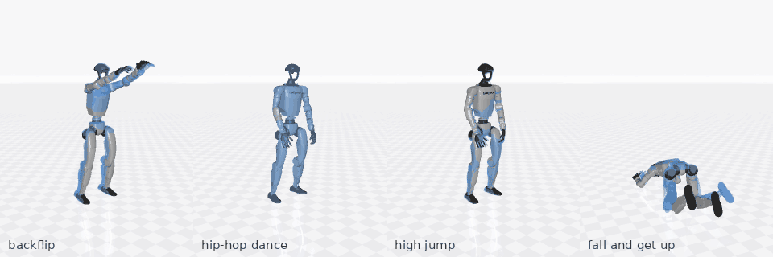
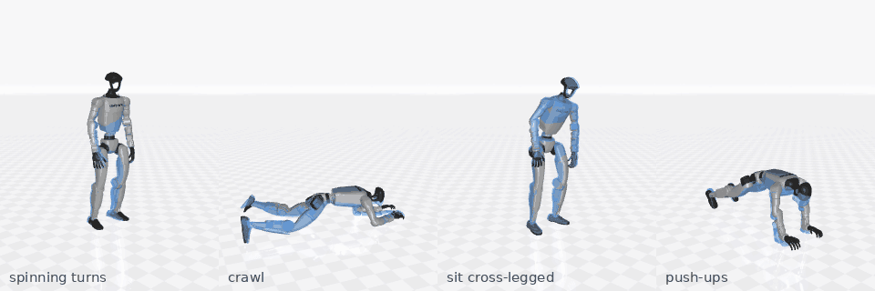
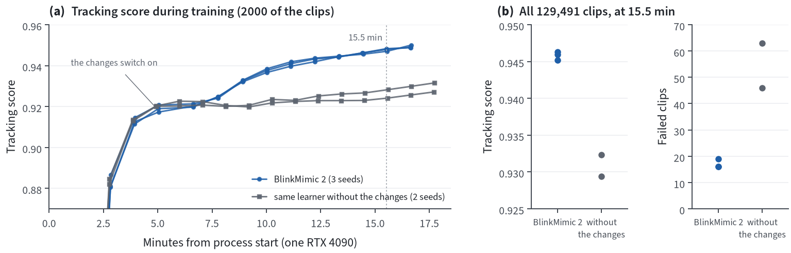
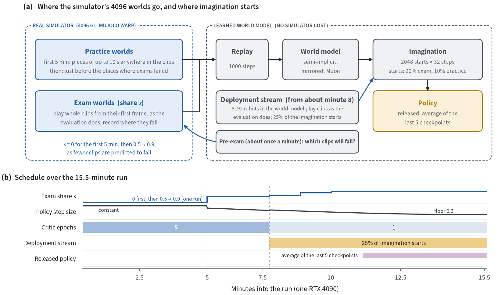

# BlinkMimic 2

**One humanoid motion-tracking policy for all 129,491 clips of BONES-SEED, trained in about 15 minutes on one RTX 4090.**

[SuperMimic](https://supermimic.github.io/) ([paper](https://arxiv.org/abs/2610.28480),
[code](https://github.com/HybridRobotics/supermimic)) showed that one policy can track a whole motion library when it
is trained by backpropagating through a learned, differentiable world model of the robot. On BONES-SEED it reached the
tracking quality of [SONIC](https://doi.org/10.1126/scirobotics.aed4592) (trained on 128 GPUs for about a week) with
one H100 in about three hours. [InstantTrack](https://github.com/Huy-Quang-Dao/instantTrack) and
[BlinkMimic](https://github.com/fuyichen0725/blinkmimic) made this learner much faster on the 40 clips of LAFAN1.

BlinkMimic 2 brings this speed to the full BONES-SEED library and studies which changes make training faster.
**One policy for all 129,491 clips trains in 15.5 minutes on one RTX 4090, with 17 failed clips** (mean of three
seeds). The main changes are exams, in which simulated robots play whole clips as the evaluation does, and a step size
planned for the short run ([how it works](#how-it-works)).



*Training time to each reported result on BONES-SEED (log scale). The other bars are the numbers each project
reports, with its own evaluation and hardware, so they are not on one scale; realmimic's released weights are also
scored by our evaluation. Sources: [SuperMimic](https://arxiv.org/abs/2610.28480),
[supermimic-prime](https://github.com/xkhainguyen/supermimic-prime),
[SuperMimic-Reproduced](https://github.com/CuboiLeo/SuperMimic-Reproduced),
[realmimic](https://github.com/kevinhenryzz/realmimic),
[SuperMimic-Rep](https://github.com/LaoYang1994/SuperMimic-Rep),
[supermimic_vibe](https://github.com/dhmbb2/supermimic_vibe),
[SONIC](https://doi.org/10.1126/scirobotics.aed4592) (as scored by SuperMimic).*




*One trained policy in the simulator, each clip played from its first frame. Solid: robot; translucent blue: the
reference motion. Every clip shown was tracked to its end in the evaluation on all clips and in at least 137 repeated
runs.*

## Results

| | training | clips tracked to the end | failed clips | tracking score |
|---|---|---|---|---|
| **BlinkMimic 2** (mean of 3 seeds) | **15.5 min**, one RTX 4090 | **99.987%** | **17** of 129,491 | **0.946** |
| [realmimic](https://github.com/kevinhenryzz/realmimic) released weights, for scale | about 10.5 h, one RTX 4090 | 99.988% | 16 of 129,491 | 0.950 |

Every clip is played once from its first frame in the simulator, without randomization, and both rows are scored by
the same evaluation.

- **Failed clip**: the robot falls or drifts away from the reference before the clip ends (pelvis more than 25 cm
  above or below the reference, or the body tilted far from it).
- **Tracking score**: how closely the robot's body follows the reference, averaged over the frames of each clip and
  then over clips. 1 would be an exact match on every frame; frames after a failure count as 0.
- **Training time**: from starting the program to the end of training, including start-up and compilation.

<details>
<summary>Per seed</summary>

| seed | training | failed clips | tracking score |
|---|---|---|---|
| 1 | 15.6 min | 16 | 0.9459 |
| 2 | 15.5 min | 19 | 0.9452 |
| 3 | 15.5 min | 16 | 0.9463 |

These runs also wrote diagnostic snapshots that the released code no longer writes, so its training time can be
slightly lower.
</details>

**Which clips fail.** Floor work (sitting, lying, kneeling, getting up, crawling) is the largest group, but the
failures spread over many kinds of motion, and they happen partway through a clip (median 55% of its length), not at
its end:

| kind of motion | seed 1 | seed 2 | seed 3 |
|---|---|---|---|
| sitting, lying, kneeling, getting up | 4 | 7 | 3 |
| dances and spins | 6 | 4 | 4 |
| flips, rolls, jumps | 2 | 1 | 7 |
| walks and jogs with sharp turns, unusual gaits | 4 | 6 | 1 |
| crawling | 0 | 1 | 1 |
| **total** | **16** | **19** | **16** |

The seeds mostly fail different clips: the 51 failures fall on 43 different motions (a clip and its mirror counted
once). Every failed clip, with the frame where it fails, is in the [released results](#released-files).

**How precise these numbers are.** The GPU simulator is not bitwise reproducible. Evaluating the same policy again
moves the tracking score by about 0.00001 but can change which clips fail; the number of failed clips behaves like a
count of rare events, about ±4 around 16. Differences of a few failed clips are within this noise.

### Where the gain comes from



*Same learner, same GPU, same 15.5 minutes; the only difference is BlinkMimic 2's changes. Both runs use the same
settings for the first five minutes. From there, the plain learner levels off while BlinkMimic 2 keeps improving (left). On all
clips it ends with 17 failed clips instead of about 55, and a tracking score of 0.946 instead of 0.931 (right).*

## How it works

The learner is SuperMimic's, with BlinkMimic's speed-ups: 4096 robots in the simulator collect data, a world model
learns from it, and the policy learns by imagining short rollouts in the world model. BlinkMimic 2 changes how the
run is spent:



1. **First, practise everything** (about the first five minutes). As in SuperMimic, robots practise pieces of up to
   10 s that start anywhere in the clips.
2. **Then, take exams.** A growing share of the robots (half, rising to 90%) plays whole clips from their first
   frame, as in the evaluation, and most imagined rollouts start from where these exams went. Imagined falls are
   penalized.
3. **Practise where exams fail.** The other robots restart just before the places where exams failed.
4. **Free extra exams in the world model.** The policy also plays clips inside the world model, which costs no
   simulation, and a quarter of the imagined rollouts start from there.
5. **Plan the step size for the run.** The learning rate decays to a floor before the end, and the released policy
   is the average of the last five checkpoints.

**Why this helps.** The imagined rollouts improve the policy only near the states they start from. Practice pieces
start on the reference motion and last at most 10 s, but the evaluation plays each clip, often much longer, from its
first frame: small errors add up, and the long sitting and lying clips, among the most common failures, fail late
(at a median of 67% of the clip). Exams bring the starting states to where the evaluation actually goes. Separately, a fixed step
size keeps the policy jittering around its optimum; planning the step for the run turned a plateau at a tracking
score of 0.933 into 0.947 with the same amount of training.

### Everything the recipe uses

Every setting below is a default of `python -m blinkmimic2.train`. Times are minutes into the run on an RTX 4090.

| | SuperMimic | BlinkMimic | BlinkMimic 2 | flag |
|---|---|---|---|---|
| **Learner** | | | | |
| world model learned from 4096 simulated robots; policy trained through 32-step imagined rollouts, closed by a critic | ✓ | ✓ | ✓ | `--num_envs --horizon` |
| Muon optimizer on the hidden weight matrices of policy and world model | – | ✓ | ✓ | built in |
| semi-implicit world model (predicts velocity changes, integrates positions); half of each batch mirrored left-right | – | ✓ | ✓ | `--wm_mirror` |
| actions built on top of the reference pose | – | ✓ | ✓ | `--pi_ref_skip` |
| moving average (EMA) of the policy weights is the deployed policy | – | ✓ | ✓ | `--pi_ema` |
| imagined rollouts per policy update; policy learning rate | 4096; 1× | 2048; 4×, decayed to 1× | 2048; 1.6× | `--pi_batch --pi_lr_mult` |
| world-model, policy and collection steps captured as CUDA graphs | – | ✓ | ✓ | built in |
| **Where the simulator practises** | | | | |
| practice pieces of up to 10 s that start anywhere in the clips | ✓ | ✓ | ✓ (first 5 min) | |
| 30% of practice pieces restart just before recent failures | – | ✓ | ✓ (first 5 min) | `--fail_reset` |
| evaluation-guided resets: the policy is regularly swept over all clips, 15% of resets go before its failures | – | ✓ | replaced by exams | |
| **exams** (from minute 5): a share of the robots plays whole clips from their first frame with the deployed policy, as the evaluation does but with training noise; the share starts at 0.5 and rises to 0.9 as fewer clips are predicted to fail | – | – | ✓ | `--exam_frac --share_ramp` |
| exam clips: 60% the clips closest to failing, 20% by training failure rate, 20% uniform | – | – | ✓ | `--exam_mix` |
| **pre-exams**: about once a minute the clips are played in the world model (those close to failing, plus a rotating eighth of the rest); this predicts which clips will fail and steers the exam share and clip choice, at no simulator cost | – | – | ✓ | `--exam_pre_*` |
| **frontier practice**: all other robots restart between 1 s before a place where an exam (or a pre-exam) failed and the end of that clip, each failing clip weighted equally | – | – | ✓ | `--front_share --front_win` |
| a reset in the middle of a clip starts from the action that holds the reset pose; the replay buffer is refilled when the exam robots change | – | – | ✓ | `--reset_aprev_ref --phase_refill` |
| **Where imagination starts** | | | | |
| imagined rollouts start 90% from exam states, 10% from practice (of the starts not taken by the deployment stream) | – | – | ✓ | `--start_prac_frac` |
| **deployment stream** (from about minute 8): 8192 robots inside the world model play clips from their first frame with the deployed policy, without noise, and supply 25% of the imagination starts, at no simulator cost | – | – | ✓ | `--wstream_*` |
| **failure penalty**: 3 × the predicted probability of falling, per imagined step, inside the imagined horizon only (the critic learns the plain tracking reward) | – | – | ✓ | `--fail_penalty --pen_horizon_only` |
| **Step size and the released policy** | | | | |
| learning rate: from minute 5 a cosine down to 0.3× of its starting value, reaching it shortly before the end; critic epochs 5 → 1 from about minute 8 | – | – | ✓ | `--phase` |
| released policy = average of the last five checkpoints (the last 4.5 min) | – | – | ✓ | `scripts/train.sh` |

The whole schedule is the single string `--phase` (default `FINAL_PHASE` in
[`train.py`](src/blinkmimic2/train.py)); `PRESET[baseline]` in [`scripts/presets.sh`](scripts/presets.sh) keeps the
first-five-minute settings for the whole run (the gray curves above). The paper with the analysis will follow.

## Setup

Linux x86_64, an NVIDIA GPU with a driver for CUDA 12.8 (about 19 GB of GPU memory for training), [uv](https://docs.astral.sh/uv/),
`git`.

```bash
git clone https://github.com/jyl681/blinkmimic2.git
cd blinkmimic2
uv sync      # .venv with mjlab, MuJoCo Warp, Warp, torch 2.9.0 (CUDA 12.8)
```

**Data.** BONES-SEED is not redistributed here. Accept the license on
[huggingface.co/datasets/bones-studio/seed](https://huggingface.co/datasets/bones-studio/seed), download the G1
retargets (`g1.tar.gz`, about 24 GB), and convert them (about 7 minutes with 12 workers, 13 GB of RAM for packing):

```bash
uvx --from huggingface_hub hf auth login   # the dataset is gated
uvx --from huggingface_hub hf download bones-studio/seed g1.tar.gz --repo-type dataset --local-dir data/bones_seed/raw
uv run python tools/prepare_bones.py convert --archive data/bones_seed/raw/g1.tar.gz --out data/bones_seed/shards --workers 12
uv run python tools/prepare_bones.py pack --shards data/bones_seed/shards --out data/bones_seed
sha256sum data/bones_seed/keep.txt   # d05ea3ef335802de8b80d467e5b8dd3af0029a3405cc0770bc26565528e3375d
```

`keep.txt` lists the 129,491 clips that pass the SuperMimic filter (the same list as realmimic's).

## Train and evaluate

```bash
bash scripts/train.sh logs/run_s1 --seed 1     # about 15.5 min; the trained policy is logs/run_s1/policy
bash scripts/eval_full.sh logs/run_s1/policy   # all 129,491 clips: failed clips and tracking score
bash scripts/reproduce.sh logs/reproduce       # the result above: three seeds, trained and evaluated
```

Train on an otherwise idle GPU, since the training time depends on it. The plain learner of
[Where the gain comes from](#where-the-gain-comes-from):
`source scripts/presets.sh; bash scripts/train.sh logs/base_s1 --seed 1 ${PRESET[baseline]}`.
`tools/record_clips.py` records named clips and `tools/render_gif.py` renders them (the GIFs above).

## Released files

From the [v1.0.0 release](https://github.com/jyl681/blinkmimic2/releases/tag/v1.0.0):

| file | contents | size |
|---|---|---|
| `blinkmimic2_seed1.pt`, `blinkmimic2_seed2.pt`, `blinkmimic2_seed3.pt` | the three trained policies of the results above (policy weights only, 9.1 M parameters) | 36.5 MB each |
| `eval_full.tar.gz` | results on all 129,491 clips for each policy and for the two baseline runs: the tracking score of every clip, and every failed clip with the frame where it fails | 3.8 MB |
| `training_logs.tar.gz` | training logs of every iteration, the 2000-clip curves of the figure above, and the flags of each run (three seeds, two baseline seeds) | 0.9 MB |

Evaluate or record a released policy without training:

```bash
mkdir -p weights/seed1
curl -L -o weights/seed1/ckpt_006500.pt https://github.com/jyl681/blinkmimic2/releases/download/v1.0.0/blinkmimic2_seed1.pt
bash scripts/eval_full.sh weights/seed1    # all 129,491 clips, about 9 minutes
uv run python tools/record_clips.py --ckpt weights/seed1/ckpt_006500.pt --clips flip_360_002__A305 --out flip.npz
```

The weights and results are derived from BONES-SEED. They are released under
[CC BY-NC 4.0](https://creativecommons.org/licenses/by-nc/4.0/) (non-commercial), subject to the BONES Motion Capture
Dataset License Agreement, with credit to Bones Studio; they are not covered by this repository's MIT License.

---

<p align="center"><br>
<b>If BlinkMimic 2 is useful to you, please give it a ⭐. It really helps!</b></p>

---

## Acknowledgements

- **Method.** [SuperMimic](https://arxiv.org/abs/2610.28480) (Liao et al., 2026): the learner, the BONES-SEED task
  and its evaluation. Its official code, [HybridRobotics/supermimic](https://github.com/HybridRobotics/supermimic)
  (Apache-2.0), was released after this code base was written; BlinkMimic 2 contains none of it. [BeyondMimic](https://doi.org/10.1126/scirobotics.adx8924) (Liao et al., 2026): the tracking
  reward and evaluation protocol. SuperTrack (Fussell, Bergamin, Holden, 2021) and stochastic value gradients (Heess
  et al., 2015): learning through a differentiable model. [InstantMimic](https://arxiv.org/abs/2609.09821) (Choi,
  Leem, Won, 2026): the GPU-native training loop. Muon (Jordan et al., 2024; Liu et al., 2025).
- **Code.** BlinkMimic 2 builds on [BlinkMimic](https://github.com/fuyichen0725/blinkmimic) (Fuyi Chen), which builds
  on [InstantTrack](https://github.com/Huy-Quang-Dao/instantTrack) (Huy-Quang-Dao) and
  [supermimic_vibed](https://github.com/zita-ch/supermimic_vibed) (Chong Zhang, ETH Zurich), all MIT-licensed; their
  notices are in [THIRD_PARTY_NOTICES.md](THIRD_PARTY_NOTICES.md).
- **Compared works.** [SONIC](https://doi.org/10.1126/scirobotics.aed4592) (Luo et al., Science Robotics, 2026), as
  scored by SuperMimic, and the reproductions in the comparison figure.
- **Reproductions.** [realmimic](https://github.com/kevinhenryzz/realmimic) (Kevin Henry): the clip list and the
  released weights we compare with (not included here). The clip filter follows
  [SuperMimic-Rep](https://github.com/LaoYang1994/SuperMimic-Rep). Other related open-source work:
  [supermimic-prime](https://github.com/xkhainguyen/supermimic-prime),
  [SuperMimic-Reproduced](https://github.com/CuboiLeo/SuperMimic-Reproduced),
  [supermimic_vibe](https://github.com/dhmbb2/supermimic_vibe),
  [rethinking-supermimic](https://github.com/btx0424/rethinking-supermimic), and the list in
  [awesome-supermimic](https://github.com/miao-org/awesome-supermimic).
- **Data.** Training data includes Motion Data by Bones Studio ([https://bones.studio/](https://bones.studio/)). Use of
  the underlying dataset is subject to the BONES Motion Capture Dataset License Agreement. The GIFs in `docs/media`
  and the released weights and results are derived from it and are not covered by this repository's MIT License.
- **Simulation.** [mjlab](https://github.com/mujocolab/mjlab), [MuJoCo](https://mujoco.org),
  [MuJoCo Warp](https://github.com/google-deepmind/mujoco_warp), [NVIDIA Warp](https://github.com/NVIDIA/warp)
  (Apache-2.0) and [PyTorch](https://pytorch.org) (BSD-3-Clause).

## Citation

```bibtex
@misc{blinkmimic2_2026,
  title  = {BlinkMimic 2: A Whole-Body Tracker for All of BONES-SEED in About 15 Minutes on One GPU},
  author = {Li, Jiayu},
  year   = {2026},
  url    = {https://github.com/jyl681/blinkmimic2}
}
```

Please also cite the works it builds on:

```bibtex
@inproceedings{liao2026supermimic,
  title     = {SuperMimic: Scaling Humanoid Whole-Body Control with One Differentiable World Model},
  author    = {Liao, Qiayuan and Shao, Yiyang and Long, Junfeng and Zakka, Kevin and Horowitz, Roberto and Abbeel, Pieter and Sreenath, Koushil},
  booktitle = {Conference on Robot Learning (CoRL)},
  year      = {2026},
  note      = {arXiv:2610.28480}
}
@misc{blinkmimic2026,
  title  = {BlinkMimic: Whole-Body Motion Tracking for the Unitree G1 in Minutes on One GPU},
  author = {Chen, Fuyi},
  year   = {2026},
  url    = {https://github.com/fuyichen0725/blinkmimic}
}
@misc{dao2026instanttrack,
  title  = {InstantTrack: Whole-Body Motion Tracking for the Unitree G1 in Minutes on One GPU},
  author = {Dao, Huy-Quang},
  year   = {2026},
  url    = {https://github.com/Huy-Quang-Dao/instantTrack}
}
@misc{zhang2026supermimicvibed,
  title  = {supermimic\_vibed: An Unofficial Reimplementation of SuperMimic},
  author = {Zhang, Chong},
  year   = {2026},
  url    = {https://github.com/zita-ch/supermimic_vibed}
}
@misc{henry2026realmimic,
  title  = {realmimic: a single-{GPU} reproduction of {SuperMimic} with deployment in {NVIDIA}'s {SONIC} runtime},
  author = {Henry, Kevin},
  year   = {2026},
  doi    = {10.5281/zenodo.23682224},
  url    = {https://github.com/kevinhenryzz/realmimic}
}
@inproceedings{choi2026instantmimic,
  title     = {InstantMimic: A High Performance System for Learning Physics-based Skills in Seconds},
  author    = {Choi, Ikjun and Leem, Geonho and Won, Jungdam},
  booktitle = {SIGGRAPH Asia 2026 Conference Papers},
  year      = {2026},
  doi       = {10.1145/3829340.3842170}
}
@article{liao2026beyondmimic,
  title   = {BeyondMimic: From Motion Tracking to Versatile Humanoid Control via Guided Diffusion},
  author  = {Liao, Qiayuan and Truong, Takara E. and Huang, Xiaoyu and Gao, Yuman and Tevet, Guy and Sreenath, Koushil and Liu, C. Karen},
  journal = {Science Robotics},
  volume  = {11},
  number  = {117},
  pages   = {eadx8924},
  year    = {2026},
  doi     = {10.1126/scirobotics.adx8924}
}
@article{luo2026sonic,
  title   = {SONIC: Supersizing Motion Tracking for Natural Humanoid Whole-Body Control},
  author  = {Luo, Zhengyi and Yuan, Ye and Wang, Tingwu and Li, Chenran and Casta{\~n}eda, Fernando and Chen, Sirui and Cao, Zi-Ang and Li, Jiefeng and Minor, David and Ben, Qingwei and Park, Jinhyung and Sami, David and Wang, Zi and Da, Xingye and Ding, Runyu and Hogg, Cyrus and Song, Lina and Lim, Edy and Jeong, Eugene and He, Tairan and Xue, Haoru and Xiao, Wenli and Yuen, Simon and Kautz, Jan and Chang, Yan and Iqbal, Umar and Fan, Linxi and Zhu, Yuke},
  journal = {Science Robotics},
  volume  = {11},
  number  = {117},
  pages   = {eaed4592},
  year    = {2026},
  doi     = {10.1126/scirobotics.aed4592}
}
@misc{bones2026seed,
  title  = {BONES-SEED: Skeletal Everyday Embodiment Dataset},
  author = {{Bones Studio}},
  year   = {2026},
  url    = {https://huggingface.co/datasets/bones-studio/seed}
}
@article{zakka2026mjlab,
  title   = {mjlab: A Lightweight Framework for {GPU}-Accelerated Robot Learning},
  author  = {Zakka, Kevin and Liao, Qiayuan and Yi, Brent and Le Lay, Louis and Sreenath, Koushil and Abbeel, Pieter},
  journal = {arXiv preprint arXiv:2601.22074},
  year    = {2026}
}
@article{fussell2021supertrack,
  title   = {SuperTrack: Motion Tracking for Physically Simulated Characters using Supervised Learning},
  author  = {Fussell, Levi and Bergamin, Kevin and Holden, Daniel},
  journal = {ACM Transactions on Graphics},
  volume  = {40},
  number  = {6},
  year    = {2021},
  doi     = {10.1145/3478513.3480527}
}
@misc{jordan2024muon,
  title  = {Muon: An optimizer for hidden layers in neural networks},
  author = {Jordan, Keller and Jin, Yuchen and Boza, Vlado and You, Jiacheng and Cesista, Franz and Newhouse, Laker and Bernstein, Jeremy},
  year   = {2024},
  url    = {https://kellerjordan.github.io/posts/muon/}
}
```

## License

MIT ([LICENSE](LICENSE)). Copyright (c) 2026 Jiayu Li; portions Copyright (c) 2026 Fuyi Chen (BlinkMimic), (c) 2026 Huy-Quang-Dao
and (c) 2026 ETH Zurich, Chong Zhang. Data-derived files are excluded; see above.
